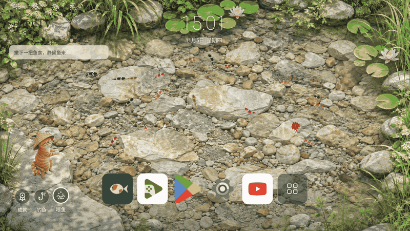

# GenTV Fish Launcher

**Your TV home screen can be a living pond.**

[中文](README.md) · [Build & install](android/README.md) · [Privacy](PRIVACY.md) · [MIT License](LICENSE)

GenTV is an interactive Android TV home screen where you can watch koi, feed them, and wake a fishing cat to catch fish from the same living pond. Apps remain within reach, while your home screen becomes somewhere worth staying.

## A home screen you can interact with

- **Feed the pond:** pellets fall onto the water with a splash; fish approach and eat.
- **Go fishing:** a fish must enter the area beneath the float before a 50% bite roll. There is no timer-only catch. A caught fish leaves the pond and a replacement swims in from the edge.
- **Enjoy the details:** koi swim in loose groups or wander alone, a turtle paddles slowly, raindrops ripple, and maple leaves drift toward the bank.
- **Keep apps simple:** five editable favorites, an All Apps button, and up to two recent apps excluding favorites. Recents only track apps opened through GenTV.
- **Navigate with your remote:** a six-column, two-row paged library with smooth white focus movement.
- **Let the scenery breathe:** after 15 seconds, the clock and controls fade to 30% opacity without disappearing.
- **Stay local:** no account, ads or analytics SDK. The Android app does not request internet access.

“Keep fish” means interactive viewing and feeding; this is not a breeding, leveling, or hunger-management game. The hero GIF is captured from the Android engine on an isolated TV emulator, not a concept animation.

## Build

Requirements: JDK 17+, Android SDK 35, Android 6.0 / API 23+ target device with OpenGL ES 2.0.

~~~sh
git clone https://github.com/Elaine-Lynn/GenTV-launcher_fish.git
cd GenTV-launcher_fish
sh android/gradlew -p android :app:assembleDebug
adb -s YOUR_DEVICE_SERIAL install -r android/app/build/outputs/apk/debug/app-debug.apk
adb -s YOUR_DEVICE_SERIAL shell am start -n com.gentv.fishlauncher/.MainActivity
~~~

Published builds, when available, are listed in [Releases](https://github.com/Elaine-Lynn/GenTV-launcher_fish/releases). Installation does not automatically replace your default Home or disable other apps.

The current package is com.gentv.fishlauncher, version 1.11.0. Apps using an older package name keep separate private data. Automatic migration is not implemented; preserve your old installation if you need its settings or catches.

Device firmware, screensavers, remote mappings and GPU drivers can affect behavior. A 60 FPS option is not a promise of 60 FPS on every device. Samsung Tizen and LG webOS cannot install this Android APK.

## Develop

~~~sh
npm run check
npm test
sh android/test-simulation.sh
python3 tools/check_public_source.py
~~~

See [CONTRIBUTING.md](CONTRIBUTING.md). Instrumentation tests modify local test data; run them only on an isolated device.

## License and contact

Project code and supplied assets are available under the [MIT License](LICENSE). Third-party copyright notices and brand rights remain separate; see [THIRD_PARTY_NOTICES.md](THIRD_PARTY_NOTICES.md).

Maintainer: [Elaine-Lynn](https://github.com/Elaine-Lynn). Use [Issues](https://github.com/Elaine-Lynn/GenTV-launcher_fish/issues) for feedback.
