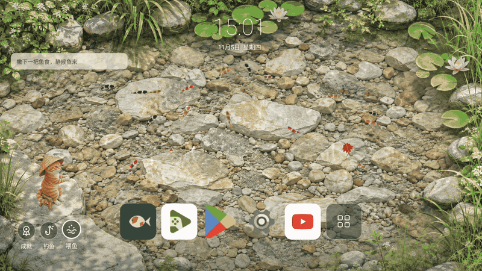
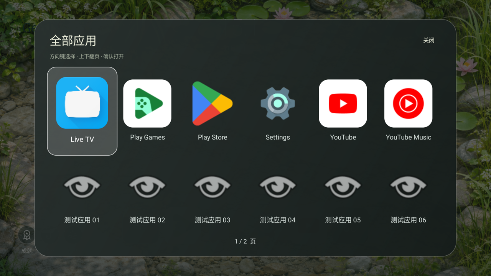

  

<h1 align="center">GenTV · 一池美景，满屏生机</h1>

<strong>电视桌面，本身就该是一池美景。</strong> 可以养鱼、可以钓鱼的互动式电视桌面。

  
  
  
  

  <a href="#开始使用">开始使用</a> · <a href="#把电视桌面从入口变成风景">产品亮点</a> · <a href="#遥控器就能完成的事">遥控操作</a> · <a href="README.en.md">English</a>

---

## 把电视桌面，从入口变成风景

很多时候，我们打开电视，只是想让客厅多一点生气。

GenTV 把应用入口留在触手可及的地方，把屏幕还给一池清水。锦鲤自在巡游，乌龟慢慢划水，偶尔一片枫叶落进池中；小猫戴着斗笠守在岸边，等一尾有缘的鱼。

**不只看鱼游过，你也可以参与这片风景。** 撒下一把鱼食，看鱼群靠近；唤醒打盹的小猫，等真正游到浮漂下方的鱼中钩。一次喂食、一场等待、几尾今日渔获，让常用的电视桌面，也有了值得停留的理由。

### 可以养鱼

鱼会游荡、结伴、短暂离群、觅食与避让。投下的鱼食分批落水，带起水花和涟漪，鱼群随后靠近。这里的“养鱼”是观鱼、投喂与互动，没有等级、繁殖或饥饿惩罚，也不需要每日打卡。

### 也可以钓鱼

池畔的小猫会打盹，也会在你唤醒后抛竿。钓获来自池里真实游动的鱼：鱼进入浮漂下方区域，才有 **50% 概率**中钩；没有鱼经过，就耐心等候。钓起的鱼从池里移出，新的鱼从岸边游入。今日渔获、重量和功德都在设备本地记账。

### 风景一直在发生

独立运动的水面波光、鱼尾与胸鳍、缓慢划水的乌龟、偶发水滴和漂浮枫叶，共同构成一幅持续变化的池塘。15 秒无操作后，时钟和控件降至 30% 不透明度，**风景继续，入口仍在**。

### 好看，也是一款真正的电视桌面

- **五个常用位置**：长按替换，按自己习惯安排。
- **最多两个最近应用**：自动过滤常用位，避免重复占位；仅记录从 GenTV 打开的应用。
- **六列应用库**：图标在上、名称在下，每页两行，遥控器上下翻页。
- **舒缓的白色焦点**：一眼知道选中了谁，移动时平滑跟随。
- **原生渲染**：Java + OpenGL ES 2.0；支持 720p / 1080p 和 30 / 60 FPS 设置。
- **安静而独立**：无需账号，没有广告或统计 SDK；Android 主应用不申请网络权限。

> 首图为项目 Android 引擎在隔离电视模拟器中的真实录屏，经本地转换为循环 GIF；它不是概念渲染。实际帧率和清晰度取决于设备、固件与设置。

## 看看应用库

桌面只保留一行常用入口，其余应用收在清晰的分页网格里。应用图标读取自设备上已安装的 App，第三方标识归各自权利人所有。

## 开始使用

### 下载

安装包如已发布，会出现在 [GitHub Releases](https://github.com/Elaine-Lynn/GenTV-launcher_fish/releases)。仓库源码可直接构建；没有 Release 时请按下方步骤生成测试 APK，不从不明网盘下载所谓“官方包”。

- 系统：Android 6.0 / API 23 及以上。
- 设备：支持 OpenGL ES 2.0 的 Android TV、Google TV 或 Android 电视盒子。
- 操作：方向键、确认、返回和菜单键。
- 三星 Tizen、LG webOS 等非 Android 平台不能直接安装 APK。
- 不同电视固件对默认 Home 的限制不同，安装成功不等于已经接管默认桌面。

### 自行构建

需要 **JDK 17+、Android SDK 35**。第一次构建需要联网下载 Gradle 依赖。

~~~sh
git clone https://github.com/Elaine-Lynn/GenTV-launcher_fish.git
cd GenTV-launcher_fish
sh android/gradlew -p android :app:assembleDebug
~~~

输出：

~~~text
android/app/build/outputs/apk/debug/app-debug.apk
~~~

安装到你自己的已授权测试设备：

~~~sh
adb -s YOUR_DEVICE_SERIAL install -r android/app/build/outputs/apk/debug/app-debug.apk
adb -s YOUR_DEVICE_SERIAL shell am start -n com.gentv.fishlauncher/.MainActivity
~~~

**默认桌面由你决定。** 安装和启动不会自动停用原桌面、修改 Home 键或更改其他应用。确认运行正常后，可在系统支持的 Home 设置中自行选择 GenTV。

### Release 与签名

~~~sh
sh android/gradlew -p android -PunsignedRelease :app:assembleRelease
~~~

上面生成的是未签名 Release，不能直接安装。正式发行须使用维护者管理的密钥；不要公开私钥或密码。详细配置见 [Android 开发说明](android/README.md)。

## 遥控器就能完成的事

| 所在位置 | 操作 | 结果 |
| --- | --- | --- |
| 桌面 | 左 / 右 | 切换常用应用、全部应用与最近应用 |
| 桌面 | 下 | 留在当前图标，不切入隐藏行 |
| 常用应用 | 长按确认 | 打开应用库，替换当前位置 |
| 全部应用 | 确认 | 打开应用库 |
| 应用库 | 左 / 右，上 / 下 | 六列导航；到页边缘后上下翻页 |
| 应用库 | 返回 | 关闭弹窗，恢复入口焦点 |
| 桌面菜单键 | 菜单 | 调整鱼数、游速、分辨率和帧率 |
| 池塘按钮 | 喂鱼 / 钓鱼 / 成就 | 投食、唤醒小猫、查看本地今日渔获 |

桌面第一项按左键可进入池塘按钮。闲置变淡后，第一下遥控操作用于唤醒界面，随后继续导航。

## 隐私与本地数据

- 没有账户、云同步或远程渔获上传。
- Android 主应用不声明 INTERNET 权限，也不读取系统全量应用使用历史。
- 应用列表通过系统 PackageManager 读取，用于展示和启动应用。
- 设置、常用位、从本桌面打开的最近应用、今日渔获存于应用私有目录。
- 清除应用数据或卸载会删除这些记录，日账以设备的本地日期为准。

完整说明见 [PRIVACY.md](PRIVACY.md)。

## 已知边界

- 本项目当前为 **1.11.0**，包名 <code>com.gentv.fishlauncher</code>。
- 与使用其他包名的旧版是独立应用，暂不支持跨包名自动导入设置和渔获。迁移前保留旧应用，不通过卸载来“升级”。
- 屏幕中的养鱼是互动观赏体验，并非生物模拟或宠物成长游戏。
- 固件遥控映射、系统屏保、Home 权限和 GPU 驱动可能影响表现，需要在目标设备上验证。
- 本项目不承诺所有设备都达到 60 FPS；60 FPS 是设置选项，不是统一性能保证。

## 开发与贡献

~~~sh
npm run check
npm test
sh android/test-simulation.sh
sh android/gradlew -p android :app:assembleDebug :app:assembleDebugAndroidTest
python3 tools/check_public_source.py
~~~

- [参与贡献](CONTRIBUTING.md)
- [安全报告](SECURITY.md)
- [素材来源与生成说明](docs/ASSETS.md)
- [第三方声明](THIRD_PARTY_NOTICES.md)
- [公开源码检查说明](docs/PUBLICATION-REVIEW.md)

Instrumentation 会操作本地测试数据，只在隔离的测试设备上运行，不在日常使用的电视上执行。

## License & contact

本项目自有代码和随项目提供的素材按 [MIT License](LICENSE) 提供；第三方组件和品牌遵循各自许可与权利。

维护者与项目联系入口：[Elaine-Lynn](https://github.com/Elaine-Lynn)。功能建议和普通问题请提交到 [Issues](https://github.com/Elaine-Lynn/GenTV-launcher_fish/issues)。

**留一池美景给客厅，也留一点闲心给自己。**
